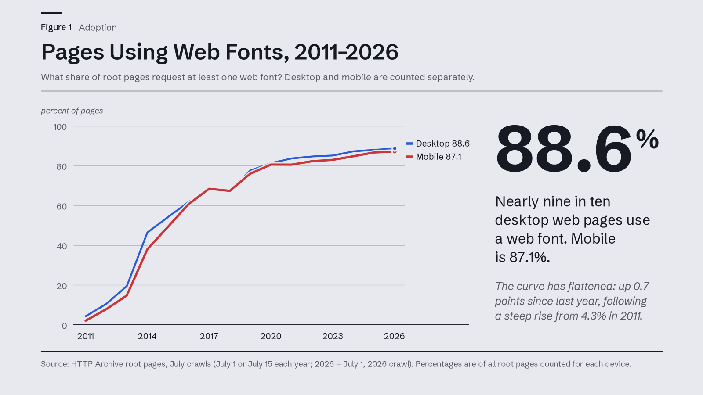
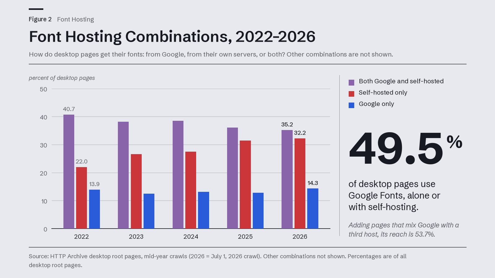
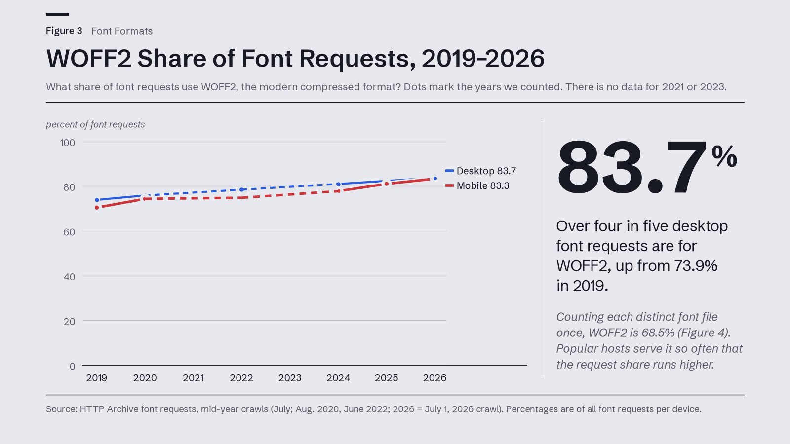
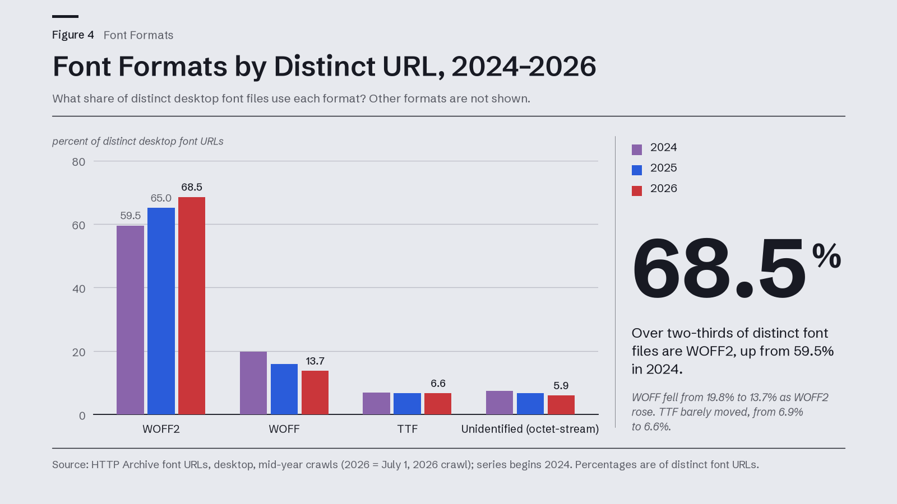
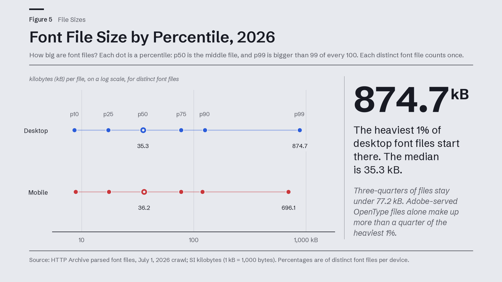
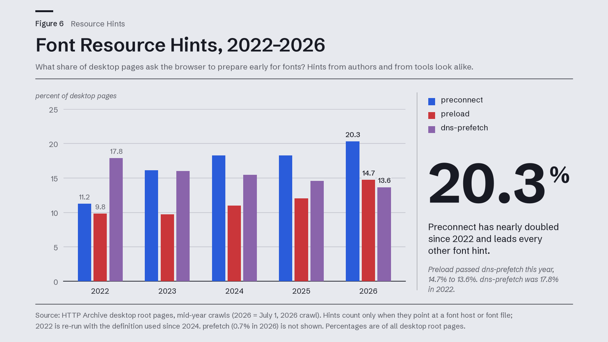
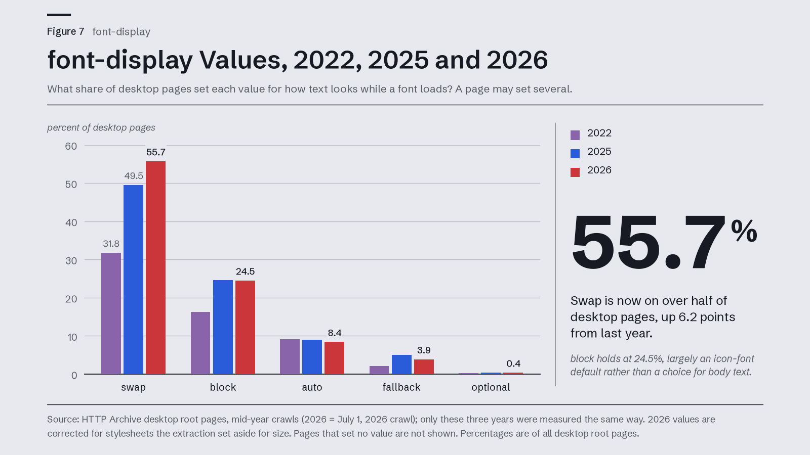
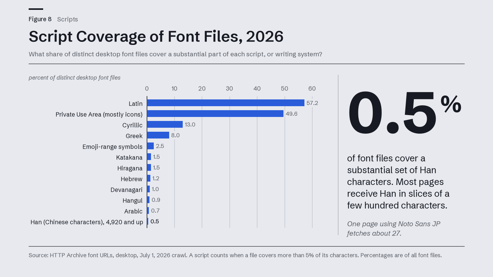
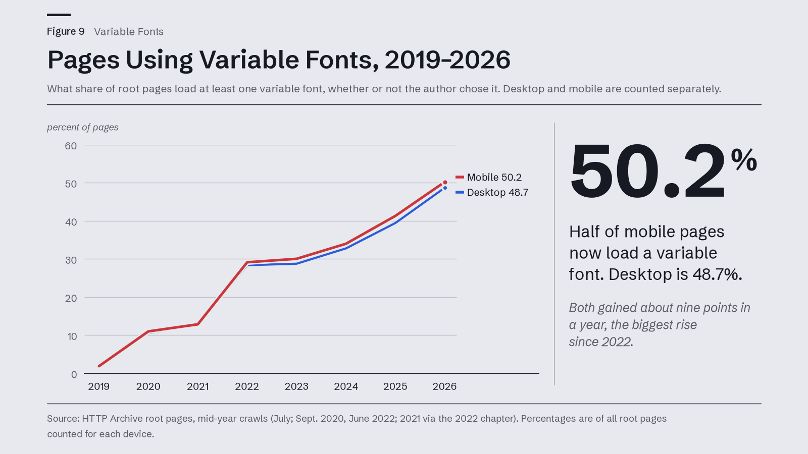

# Fonts on the Web in 2026

### Charles Berret

#### Google Fonts · October 23, 2026 · Draft v10

# Introduction

This report is a census of web typography in 2026. The annual Web Almanac will not be published this year, so we ran the same analysis independently on the HTTP Archive’s July 2026 crawl, which covers 11.6 million desktop pages and 15.5 million mobile pages. In this year’s crawl, web fonts were found on 88.6% of desktop pages and 87.1% of mobile pages, up by about 0.7 points from 2025. That small gain is the shape of the curve now: a steep rise in the early years, then a plateau. In 2011, when web fonts were still new, nineteen out of twenty pages settled for system fonts. Figure 1 traces the climb since then. Today, web fonts are essential front-end infrastructure: the appearance and performance of nearly nine out of ten sites depends on how web fonts are hosted, formatted, and delivered, whether from a site’s own servers or from a service such as Google Fonts.

> *Figure 1: Pages using web fonts, 2011–2026. This dataset counts the share of root pages requesting at least one web font. This fifteen-year span follows web fonts from a new technology to nearly nine in ten pages.*

The high prevalence of web fonts forms the backdrop of this year’s report, but it’s not the full story. What about the remaining ~12% of pages? Web crawling can’t tell us why a web site isn’t shipping a web font. Deliberate system-font stacks are one candidate (system-ui alone is declared on ~14.5% of pages), and the crawl may also find no web fonts simply due to minimal site designs or broken configurations. But whatever the reason for using them, system fonts are still used on about 11.4% of websites, though this share is still diminishing every year.

For web pages still using system fonts, the main drawbacks are not just aesthetic, but also functional. System fonts serve Latin text well because that’s the writing system most were originally designed to serve, but system fonts are not so neutral everywhere in the world. On a computer running Japanese Windows, system-ui resolves to Yu Gothic UI, a face that one contributor to the CSS Working Group’s issue tracker calls “not suitable for long text”[^1]. For Urdu or Arabic, the platform’s fallback is where text breaks: shaping fails when the browser switches fonts in the middle of a word. Firefox has had an open bug report about broken Urdu system fonts since 2016.[^2] And despite growing coverage of the world’s many writing systems in free web font libraries like Google Fonts, delivery remains harder for some languages than for others. A Latin typeface made for English alone can fit in a few dozen kilobytes, while one for Chinese characters can run to several megabytes, and the web must deliver both without making the reader wait.

For the pages that do ship web fonts, the question in 2026 is not whether the web uses them, but how, and whether those uses reflect their full potential. The answer comes in three parts.

**1. Web font practice has settled, and that shows in how readily new technical features spread.** Variable fonts reached half the web this year: 50.2% of mobile pages and 48.7% of desktop load at least one, up about nine points from 2025. WOFF2 keeps consolidating, font-display: swap keeps winning, and self-hosting holds at about seven pages in ten. For the Latin-script commercial web, web fonts look like a solved problem with settled best practice.

**2. Supporting the world’s writing systems remains difficult: the problem of delivering multi-megabyte files for the largest character sets has been centralized rather than solved.** By request count on desktop, the busiest variable-font family is not Roboto but Noto Sans JP, which Google serves in a couple of dozen subset files to every page that uses it. That splitting is the workaround. The Japanese web typography this crawl can see runs largely on Google’s infrastructure, which subsets those enormous fonts so that individual sites don’t have to, and it evidently scales.

**3. The technology designed to solve that problem for any host is Incremental Font Transfer, but adoption remains a measured zero in the leadup to its official release.** The only IFT opt-in so far appears on one site in a crawl of 11.6 million desktop and 15.5 million mobile pages, and there it is attached to ordinary WOFF2 files rather than incremental ones. We treat that zero as a baseline: a null on every check we ran, measured before any browser ships IFT support, against which next year’s data can be read.

The rest of this report walks through the evidence underlying these three main takeaway points. We start with how fonts are hosted and shipped, then how pages load them, which families and licenses dominate, and what the font files can do versus what authors actually ask of them. The analysis ends with the scale problem itself, and with why several of our measurements point at the same gap.

## Measurement Units: Pages, Requests, Distinct URLs, and Parsed Fonts

Every percentage in this report names its denominator. Because the same fact can be measured on the level of web pages, requests, distinct font URLs, or parsed font files, we must explicitly distinguish between these four counting methods and what they mean.

- **Pages:** The share of root pages in the July 1, 2026 crawl (about 11.6 million desktop and 15.5 million mobile), following the Web Almanac’s methodology. Unless we say otherwise, a percentage is a share of pages.

- **Requests:** The share of all font requests on those pages. A font requested several times counts several times, so this method weights by traffic.

- **Distinct font URLs:** The share of unique font file URLs, which counts each file once however many pages use it. We report format mix on this basis for year-over-year comparison, with request shares called out separately (i.e., on desktop, WOFF2 is 68.5% of unique URLs but 83.7% of requests).

- **Parsed fonts:** the share of distinct font files whose metadata the crawler could read, which we use for scripts, OpenType tables, and variable-font axes.

A few definitions and caveats also apply throughout. *Self-hosted* means served from anywhere other than a recognized font service, so the category includes public CDNs and site builders. In practice, the share of all desktop pages by font source is as follows (the sources overlap, since a page can draw on more than one):

- Own domain: 54.5% (about three in four of those that self-host)

- Smaller third-party hosts the classifier doesn’t name: 15.7% (about one in six), including regional platforms, minor site builders, and privacy mirrors

- Public CDNs such as cdnjs: 3.2%

- Site builders such as Wix and Shopify: 2.6% and 1.9%, respectively

Variable-font axis figures distinguish axes *present in files* from axes *set in CSS*, and the latter are measured only among the pages that use font-variation-settings at all. Figures derived from CSS have been corrected for the stylesheets our 2026 extraction set aside for size (see Appendix B). A comparison with earlier years is therefore also a comparison across methods, so where a CSS figure fell against 2025 we report the 2026 level and draw no trend from it. The crawl’s CSS parser also stops reading after @layer blocks, so CSS-derived figures are floors. Comparisons with 2022 reach back to a smaller crawl (about 7.3M desktop and 10.3M mobile root pages, against roughly 12M and 15M-plus since 2023), so a few points of movement across that boundary is weaker evidence than the same movement within it. Finally, the crawl covers root pages of popular sites in more than 200 countries and territories, drawn from Chrome’s UX Report (desktop and Android Chrome users only)[^3] and loaded from data centers in the United States.[^4] It probably underrepresents mainland China, where Chrome’s reporting services do not operate, which matters most in the section on scripts. By declared language, about three in four root pages are in a Latin-script language. Appendix B gives the mix by language and country.

# Font Delivery: Self-Hosting and Third-Party Services

This year’s crawl confirms that self-hosting is the most widespread way of delivering web fonts. About seven in ten pages self-host at least one font (71.4% desktop, 70.2% mobile), steady since 2025 after climbing from 67% in 2022. Broken down by Google Fonts, self-hosting, or the two together, the pattern is simple:

##### Table 1. Web fonts by hosting type, 2026

Share of desktop and mobile root pages by hosting pattern. Patterns outside these three (Adobe hybrids, Font Awesome CDN mixes, Japanese hosts) form a long tail, with none above about 1%.

| **Pattern**          | **Desktop** | **Mobile** |
|----------------------|-------------|------------|
| Google + self-hosted | 35.2%       | 34.0%      |
| Self-hosted only     | 32.2%       | 32.9%      |
| Google only          | 14.3%       | 14.5%      |

Three combinations cover four-fifths of pages. (Google’s two rows sum to 49.5%; its 53.7% reach, below, includes pages that mix it with a third host.) Exclusive self-hosting has risen ten points on desktop since 2022 (22.0% → 32.2%), but it barely moved this year (+0.7 points), and the Google-plus-self-hosted hybrid remains the single most common recipe on desktop. Mobile shares moved by 2–3.5 points this year; for the reason we give under Google Fonts below, we don’t read the mobile movement. The 2022 chapter tentatively tied a migration off the font CDNs to browser cache partitioning and GDPR[^5]; four years on, desktop sites have indeed moved. The movement is real but gradual.

> *Figure 2: Font hosting combinations, 2022–2026. Dataset counts the share of desktop pages using self-hosted fonts (red), Google Fonts (blue), or a combination of the two (purple). Google Fonts, alone or combined with self-hosting, reaches 49.5% of desktop pages in this year’s crawl (53.7% counting pages that also use a third host).*

Much of that self-hosting is Google’s catalog under another address. More than a third of self-hosted font requests that carry a family name are for Google Fonts families (at least 35.7%, or 44% if we exclude Font Awesome’s icon font files; about a tenth of self-hosted requests carry no family name and are left out of both). Increasingly, a tool did the copying: at least one page in eight (12.5% on desktop, up from 3.1% in 2022) serves fonts from a path that a build tool or plugin left behind. The largest single trace is Elementor’s local Google Fonts folder (5.2% of font-using pages), and it appeared all at once. Elementor, a WordPress page builder, switched local loading of Google Fonts on by default for all sites in March 2025 (version 3.28), four months before that year’s crawl, and off again by default in September 2025[^6]; whether the share falls from here is a question for 2027. The steadiest grower is Next.js, whose font system downloads Google’s files at build time and whose share of font-using pages has risen every year, twentyfold since 2022 (0.13% → 2.84%). WordPress’s Font Library, Astro and Nuxt do the same, and bundlers that rename files with content hashes hide most of the rest, so these are floors. Copying does not end the relationship with Google: the site’s build machine now fetches from Google’s API instead of the visitor, and builds fail when Google’s files move.

Why move at all? Practitioners give two reasons. Since browsers began partitioning their caches by site (Chrome did so in 2020)[^7], a font fetched from Google for one site is no longer reused by the next, which removed the old argument for a shared CDN. In Europe, court rulings added a second reason. In January 2022 a Munich court held that a site had no legitimate interest in sending its visitors’ IP addresses to Google, since Google’s fonts can be served without contacting Google[^8], and a wave of warning letters to site owners followed in the late summer and autumn.[^9] The crawl shows where and when, not why, but the pattern is specific. On German and Austrian domains, Google’s presence on font-using pages halved between the July 2022 and July 2023 crawls (.de from 44.6% to 21.7% on desktop, .at from 54.0% to 27.0%). No other large domain moved as much as nine points, and the step has held since. Defaults moved with the law: WordPress’s theme reviewers asked for locally hosted fonts in mid-2022[^10], Next.js 13 shipped its build-time download that October[^11], and WordPress’s Font Library has copied Google’s files to the site’s own server since 2024.[^12] Few sites switched CDNs instead. Bunny Fonts, a privacy-motivated drop-in for Google’s API[^13], serves fonts to about one page in two hundred (0.5%), and no more often on German domains than on .com. (A top-level domain is not a country.)

## Regional Self-Hosting: Iran, Russia, China, and Japan

Elsewhere the same move has other causes, and Google’s share rises in some markets and falls in others. (The shares in this subsection use font-using pages as the denominator, so they run higher than the all-page shares above.)

- **Iran:** about four in five font-using pages on .ir self-host only (82.2% on desktop). Developers there describe requests to Google’s font hosts that hang under filtering and sanctions rather than fail outright, and they serve open Persian fonts such as Vazirmatn from their own servers.[^14]

- **Russia:** Google’s desktop share of font-using pages on .ru fell 12 points between 2022 and 2026 (60.4% → 48.3%), as sites read the personal-data law cautiously and some network operators blocked Google’s hosts.

- **China:** from the mainland, Google Fonts is unreliable rather than simply blocked. Sites reach it through Google-operated .cn endpoints and community mirrors[^15]. Our classifier recognizes only Google’s .com font hosts, so it counts those pages as self-hosted; they amount to a few hundred pages in this crawl, whose site list likely underrepresents the mainland web.

- **Japan** runs the other way: it is the one large domain where Google’s desktop share rose (68.1% → 72.1%), which fits a script in which Google’s slicing is the service itself.[^16]

Licensing pulls toward Google in several markets too. Where commercial web licenses are costly, litigated (font lawsuits in Russian courts grew two and a half times in five years)[^17] or impossible to buy under sanctions, the free OFL catalog is the legally safe channel. Mostly, the sites that leave Google’s servers keep open fonts, and often Google’s own catalog.

## Google Fonts Page Share

Counting any page that fetches a font from Google’s infrastructure, we find Google Fonts on 53.7% of desktop and 51.9% of mobile pages. The desktop figure is essentially flat against 2025 (53.6% → 53.7%) and down six points from 59.8% in 2022, lost in two steps: at the 2023 enlargement of the crawl, and again in 2025.

The mobile figures need more careful treatment. Our own multi-year series had mobile Google at 46–47.5% for three consecutive crawls (2023–2025). The 2026 crawl reads 51.9%, which happens to match the mobile reading in the smaller 2022 crawl (51.5%), while desktop didn’t move at all. The three lower readings began with the 2023 enlargement of the crawl, so the series has two steps rather than one, and it isn’t obvious which level is the odd one. The query definition is unchanged. We could not identify a mechanism. Crawl composition, service-detection edge cases, and real product shifts are all candidates, so we decline to narrate a mobile trend in either direction. What the data does support is the level: Google’s fonts touch more than half of desktop pages in every crawl since 2022, and more than half of mobile pages in this year’s reading.

One distinction matters more than the mobile step: a share of pages that call Google’s servers is not a share of pages that use Google’s catalog. The second is at least as high, and probably higher, because so much self-hosting is Google’s families copied by a tool, and the crawl can only bound it from below.

The other services are much smaller. Adobe Fonts sits at 4.0% of desktop and 3.2% of mobile pages, and the Font Awesome CDN at 3.0% and 2.6%. That last figure understates Font Awesome’s reach considerably: 85% of requests for its files don’t go to Font Awesome’s own CDN at all. Every other commercial host is noise at web scale, though commercial type is not quite noise: several foundries, Grilli Type and Commercial Type among them, license their web fonts for self-hosting only[^18], so their faces land in the self-hosted bucket. Identifiable commercial families make up at least 2% of self-hosted requests that carry a family name, and Grilli’s GT Standard alone ranks 13th among self-hosted families on desktop.

## Font Requests by Host

Counted by font requests instead of pages, self-hosting and Google nearly split the pipe: roughly 49% of desktop font requests are self-hosted and 45% come from Google, with Adobe around 4%. The divergence from page share comes from how many files each page pulls. On desktop, pages using Google fetch 4.6 font files from it on average, versus 3.8 from self-hosted origins, partly because Google splits large families into subsets.

Google’s files are almost perfectly uniform: about 98% of Google font requests are WOFF2 (desktop). Self-hosted traffic is less uniform. Format share of self-hosted requests:

- WOFF2: roughly 70%

- WOFF: around 12%

- mislabeled application/octet-stream: around 9%

- raw TTF: around 5%

This has held for three chapters: with self-hosting, format errors are the site’s own to fix.

Which families are behind that traffic? Within each host’s family-tagged traffic, the leaders say a good deal about what each channel is for. (These are desktop figures; shares are of each host’s requests that carry a family name, and about a tenth of self-hosted requests carry none.)

Self-hosted origins are icon-heavy. Share of self-hosted family-tagged requests:

- Font Awesome: 17.9%

- Poppins: 5.0%

- Roboto: 4.9%

- Open Sans: 3.5%

- Montserrat: 3.3%

- Inter: 2.8%

In practice, self-hosting on the public web largely means serving your own copy of the icon kit and a few Google sans faces.

Google’s traffic looks global by requests, and the look is mostly slicing. Noto Sans JP is 17.5% of Google’s family-tagged requests in the crawl, and CJK families about a third, yet Noto Sans JP reaches only 1.4% of pages (Roboto, by the same request-based measure: 20.7%). Each page that uses it fetches a couple of dozen subset files. After Noto Sans JP come Roboto (13.6%), Poppins (8.5%), Open Sans, Montserrat, Lato, and Noto Serif JP.

Adobe’s traffic is top-heavy: Proxima Nova alone is 18.3% of Adobe’s tagged requests, then Futura PT (7.7%) and a scatter of licensed classics.

# Font File Formats, Sizes, and Subsetting

## Format Mix: WOFF2 Share of Distinct Font URLs

Which font formats are found most often on the web? On the distinct-URL series (the one behind the 2025 chapter’s 65% WOFF2 figure, which that chapter loosely called requests[^19]):

##### Table 2. Font file formats, 2024–2026

Counted by distinct font URLs on desktop sites. Other formats not shown in this table include HTML (2.1%), OTF (1.6%), and plain text and sfnt (0.5% each).

<table style="width:94%;">
<colgroup>
<col style="width: 31%" />
<col style="width: 20%" />
<col style="width: 20%" />
<col style="width: 20%" />
</colgroup>
<thead>
<tr>
<th><blockquote>

<strong>Format</strong>

</blockquote></th>
<th><blockquote>

<strong>2024</strong>

</blockquote></th>
<th><blockquote>

<strong>2025</strong>

</blockquote></th>
<th><blockquote>

<strong>2026</strong>

</blockquote></th>
</tr>
</thead>
<tbody>
<tr>
<td><blockquote>

WOFF2

</blockquote></td>
<td><blockquote>

59.5%

</blockquote></td>
<td><blockquote>

65.0%

</blockquote></td>
<td><blockquote>

68.5%

</blockquote></td>
</tr>
<tr>
<td><blockquote>

WOFF

</blockquote></td>
<td><blockquote>

19.8%

</blockquote></td>
<td><blockquote>

16.0%

</blockquote></td>
<td><blockquote>

13.7%

</blockquote></td>
</tr>
<tr>
<td><blockquote>

TTF

</blockquote></td>
<td><blockquote>

6.9%

</blockquote></td>
<td><blockquote>

6.7%

</blockquote></td>
<td><blockquote>

6.6%

</blockquote></td>
</tr>
<tr>
<td><blockquote>

octet-stream

</blockquote></td>
<td><blockquote>

7.5%

</blockquote></td>
<td><blockquote>

6.6%

</blockquote></td>
<td><blockquote>

5.9%

</blockquote></td>
</tr>
</tbody>
</table>

*\
\*

Mobile tracks desktop almost exactly. WOFF2 gained another three and a half points of distinct-URL share, after five and a half the year before; WOFF keeps giving ground; TTF is stubbornly flat; and files with a misconfigured MIME type are down only slightly and remain almost entirely a problem outside the font services.

By request volume, WOFF2’s arc is longer and higher: 73.9% in 2019, 75.8% in 2020, 78.4% in 2022, 81.0% in 2024, 82.4% in 2025 and 83.7% in 2026 on desktop. These are six readings from crawls of different sizes, not a yearly series, and they run higher because high-traffic hosts amplify the modern format. (The 2024 chapter described its 81% as a share of websites, but its chart counted requests, which is why it sits on this series.)[^20]

> *Figure 3: WOFF2 share of font requests, 2019–2026. Dataset counts the share of font requests that use WOFF2, on desktop and mobile. Dots mark the years measured, and there are no data for 2021 or 2023. Desktop reaches 83.7% in 2026, up from 73.9% in 2019.*

> *Figure 4: Font formats by distinct URL, 2024–2026. Dataset counts the share of distinct desktop font URLs in each format. WOFF2 reaches 68.5% in 2026, up from 59.5% in 2024, while WOFF falls from 19.8% to 13.7%.*

Inside the files, outline technology is more settled still: TrueType glyf outlines in 92–93% of parsed fonts, PostScript CFF at 7–8%, with CFF2 and SVG-table glyphs at rounding-error levels.

## File Size Distribution

##### Table 3. Font file size percentiles, 2026

Size per distinct font file at the 50th, 75th, 90th, and 99th percentiles, for desktop and mobile pages.

| **Percentile** | **Desktop**  | **Mobile**   |
|----------------|--------------|--------------|
| p50            | **35.3 kB**  | **36.2 kB**  |
| p75            | 77.2 kB      | 77.2 kB      |
| p90            | 125.3 kB     | 119.6 kB     |
| p99            | **874.7 kB** | **696.1 kB** |

*\[font file size, per distinct font file\]*\
\
The median file size has drifted down, from about 40 kB in 2024 to 35 kB now, and three-quarters of files stay under ~77 kB. The 99th percentile is about 0.87 MB on desktop. By format, WOFF2’s median file is ~31.5 kB and raw TTF’s is ~59.5 kB; by host, Google’s median WOFF2 (~17.5 kB) is about half the size of self-hosted WOFF2 (~32.2 kB), which is consistent with aggressive subsetting.

Typical fonts are fine, then; the trouble is in the tail, and the tail has a specific shape. It is dominated by self-hosted non-WOFF2 files and, unexpectedly, by Adobe-served OpenType files: Adobe serves about 71,000 of them, with a median size of 1.6 MB, and they alone make up more than a quarter of the heaviest 1% of files.

> *Figure 5: Font file size by percentile, 2026. Dataset marks the 10th, 25th, 50th, 75th, 90th and 99th percentiles of distinct font files, on a log scale. The desktop median is 35.3 kB, and the 99th percentile is 874.7 kB.*

## Subsetting Prevalence and Google-Generated CSS

unicode-range is the CSS descriptor that tells the browser which characters each pre-split font file covers, so that it fetches only what a page needs.[^21] It appears in the CSS of 63.5% of desktop pages (63.4% mobile), up from 53–56% of pages in 2019, the last time this series measured it.[^22] At face value, range-based subsetting has become standard practice, but attribution by host shows that much of it is inherited rather than chosen.

37.2% of all desktop pages get their unicode-range rules solely from Google Fonts’ generated CSS (36.5% on mobile). That is subsetting inherited by pasting a \<link\> tag, not subsetting anyone wrote. Any unicode-range in non-Google CSS covers 26.3% of pages; first-party stylesheets alone, at least 11.6%. In other words, roughly three of every five pages with unicode-range in their CSS owe it to Google’s automation.

Inheritance cuts both ways, because a page that inherits Google’s slicing also inherits Google’s choice of slices. In 2022, Google’s single Arabic subset lacked the extended Arabic blocks that languages such as Hausa and Fulah need when written in Arabic script, and its maintainers had no plan to add one[^23]. In 2026 the CSS API still strips the OpenType case feature that Google’s own Georgian fonts need for Mtavruli, the script’s capitals.[^24]

That matters for the concentration findings at the end of this report: the technique that makes giant fonts practical exists, is proven, and on the Latin-script web is mostly deployed by one provider on authors’ behalf. Chinese, Japanese and Korean developers are the exception: for them subsetting is also a craft, with its own tools (font-spider since 2014, cn-font-split)[^25] and published measurements, and the pages that use those tools count as self-hosted. (Elsewhere it is the least discussed technique in this report: on Hacker News, unicode-range has never drawn more than a dozen comments in a year.)[^26]

# Font Loading and Text Rendering

## Resource Hint Adoption

Because web fonts can block or delay text rendering, many sites use resource hints to start font fetches earlier. Hints count here only when they point at a font host or a font file.

##### Table 4. Font-related resource hints, desktop pages, 2022–2026

Share of desktop pages using each hint. Hints count only when they point at a font host or a font file; the 2022 column re-runs that crawl with the narrower definition used since 2024.

| **Font-related hint (desktop)** | **2022** | **2025** | **2026**  |
|---------------------------------|----------|----------|-----------|
| preconnect                      | 11.2%    | 18.2%    | **20.3%** |
| preload                         | 9.8%     | 12.0%    | **14.7%** |
| dns-prefetch                    | 17.8%    | 14.6%    | **13.6%** |
| prefetch                        | 0.06%    | 0.6%     | **0.7%**  |

The ranking has inverted since 2022: preconnect has nearly doubled and now leads; preload has overtaken dns-prefetch; and the DNS-only hint continues to fade. (Preload has risen every year since 2023, including the two years the table omits.) Our extraction doesn’t say whether the preconnect gain is authors’ craft or boilerplate inherited with a font service’s embed code; after the unicode-range attribution above, that is the column to add next year.

> *Figure 6: Font resource hints, 2022–2026. Dataset counts the share of desktop pages with each hint pointing at a font host or font file. Preconnect reaches 20.3% in 2026, up from 11.2% in 2022, and now leads every other hint.*

\
Font-Display Value Distribution
-------------------------------

##### Table 5. font-display values, desktop pages, 2022–2026

Share of desktop pages declaring each font-display value. The 2025 column is recomputed and differs by a tenth of a point from the swap figure (49.6%) published in the 2025 chapter.

| **Value (desktop pages)** | **2022** | **2025** |
|---------------------------|----------|----------|
| swap                      | 31.8%    | 49.5%    |
| block                     | 16.2%    | 24.7%    |
| auto                      | 9.1%     | 9.1%     |
| fallback                  | 2.2%     | 5.0%     |
| optional                  | 0.3%     | 0.4%     |

swap (show fallback text first, then swap in the web font when it loads) is more entrenched than ever, up six points to 55.7% of desktop pages (56.0% mobile). block held at about a quarter of pages (24.5% desktop, 24.7% mobile), which fits the last two chapters’ finding that block is mostly an icon-font default rather than a choice for body text. auto and fallback read lower than in 2025; for a CSS-derived figure we report that as a level, not a decline (see Appendix B). Our advice has not changed: swap for text, block for icons[^27], and set it explicitly rather than leave the default. But swap has a cost that practitioners name: the visible shift when the web font arrives. Metric overrides (below) are the remedy. For sites that would rather not swap at all, optional, which keeps the fallback when the font is late, is the no-shift choice.[^28]

> *Figure 7: font-display values, 2022, 2025 and 2026. Dataset counts the share of desktop pages declaring each value, and a page may declare more than one. Swap reaches 55.7% in 2026, up from 49.5% in 2025.*

*\*

## Metric Overrides for Layout-Shift Reduction

First measured in this series in 2022 at a fraction of a percent[^29], the @font-face descriptors that resize and re-space a fallback font to match the web font’s metrics (size-adjust, ascent-override, descent-override, line-gap-override)[^30] now each appear on about 3% of pages. That is between fifteen and sixty times the 2022 reading, depending on the descriptor and client, a multiple that says as much about how small the 2022 base was as about the growth since. It is a sound technique for limiting layout shift, and it mostly arrives by default through frameworks such as Next.js; many of the authors using it may not know they are.[^31]

## Local Font Sources and Incremental Font Transfer 

local() **sources.** About 11% of desktop and 13% of mobile pages include local() in an @font-face src list, down from 56–59% in 2019, mostly because Google Fonts stopped emitting it in late 2020[^32]. Performance writers have warned against local() for loading web fonts since at least 2015.[^33] When names match, the browser silently uses whatever version the user has installed. Newer layout-shift guidance, though, deliberately uses it to build metric-matched fallbacks.[^34] Some of what remains is likely those fallback faces.

font-optical-sizing**.** Explicit control of the optical-size axis is rare: auto (a restatement of the default, to no effect) appears on 0.7% of pages, and none (the deliberate opt-out) on fewer than a thousand pages on each client. Browsers do this work invisibly for fonts with an optical-size axis, and essentially nobody overrides them. That silence need not mean contentment: type designers have disputed since 2019 how browsers map the axis (to CSS pixels rather than points), so the near-zero may also mean authors lack a control they trust. The one live signal is among the rare values: a hundred-odd distinct design-system custom properties (--heading-3-font-optical-sizing and kin) that pass the value through as a design token.

## Hyphenation and Line-Breaking Properties

hyphens: auto holds at about 10.5% of desktop pages, about where it was in 2025, with none and manual around 3–4% each. The newer line-breaking property is moving faster: text-wrap: balance more than doubled to 6.9% of pages, and pretty rose to 2.8% (from 1.7%).

# Families, Licenses, and Scripts

## Most Declared Font Families

Which font families are designers actually declaring? The web font families most often declared in @font-face rules on desktop pages make a short and familiar list:

##### Table 6. Most declared font families

Approximate share of desktop pages declaring each family in @font-face rules (a lower bound).

| **Family**   | **Share of pages (desktop)** |
|--------------|------------------------------|
| Font Awesome | 35.3%                        |
| Roboto       | 21.6%                        |
| Open Sans    | 15.5%                        |
| Montserrat   | 11.8%                        |
| swiper-icons | 10.9%                        |
| Poppins      | 10.5%                        |
| Inter        | 8.7%                         |
| Lato         | 8.1%                         |

Icon kits and a handful of UI sans faces still dominate the web’s font declarations, with **Inter** the mover: about 1% of pages in 2022, nearly 9% today. Generic families remain the most widely declared. Share of pages declaring each:

- sans-serif: ~86%

- monospace: ~60%

- serif: ~40%

- system-ui: ~14.5%

## Font Licenses and Vendors

The SIL Open Font License stands out: roughly 70% of all pages load at least one OFL-licensed font (69.9% desktop, 70.6% mobile), up from ~64% in 2025, and since only fonts with readable license metadata are counted, that is a floor. Vendor metadata points the same way: fonts carrying Google’s vendor ID reach ~37% of pages, and Font Awesome’s up to ~27%, while the next named vendor reaches 13.7%. Most pages (78%) load at least one font whose designer field is blank. In other words, the commons is concentrated: a small number of very large donors dominate it.

Part of the commons’ pull is price, and part is friction. A commercial web license meters something (pageviews, domains, monthly visitors or bandwidth, depending on the foundry); the OFL meters nothing.[^35] When clients choose free fonts, designers and foundries name the friction as well as the price; one Indian foundry reports that seven in ten corporate inquiries fail on budget.[^36]

## Writing System Coverage

How well do web fonts cover the world’s writing systems? For this question, the denominator matters more than anywhere else in this report, and so does the crawl’s possible tilt toward widely visited Latin-script sites. The table counts distinct font URLs, classified by the characters each file contains; a script counts when a file covers more than 5% of it, and a file can count under several scripts, so the shares overlap rather than summing to a whole. These are files, not pages, and certainly not people:

##### Table 7. Writing-system coverage of font files, desktop, 2026

Share of distinct font URLs covering each script. A script counts when a file covers more than 5% of it, and a file can count under several scripts, so shares overlap. Every row reflects the crawl’s mix of sites, about three quarters of them on Latin-script pages (Appendix B), so the smaller rows show how often a script’s fonts appear in this crawl, not how well the web serves readers of that script.

| **Script**                           | **Desktop share of font files** |
|--------------------------------------|---------------------------------|
| Latin                                | **57%**                         |
| Private Use Area (mostly icons)      | 50%                             |
| Cyrillic                             | 13%                             |
| Greek                                | 8%                              |
| Emoji-range symbols                  | 2.5%                            |
| Katakana / Hiragana                  | ~1.5% each                      |
| Hebrew / Devanagari                  | ~1%                             |
| Hangul (substantial sets)\* / Arabic | \<1%                            |
| Han (substantial sets)               | ~0.5%                           |

\* Hangul is depressed by the 5% rule: only 9% of Noto Sans KR requests (a per-request check; the table is per file) classify as Hangul.

**Han script, a writing system used by more than a billion people, appears** as a substantial set in only half a percent of the font files in the crawl. That isn’t a census of the Chinese or Japanese web, and it doesn’t mean Han is rare in fonts. It means Han rarely arrives whole. A file clears the 5% bar for Han only if it carries more than 4,920 ideographs.[^37] Google’s slices of Noto Sans JP carry a few hundred characters each[^38], so fewer than 1% of Noto Sans JP requests (again by request, not by file) register as Han at all, which is also why Katakana outranks Han in this table.

Han reaches the web as slices, about 27 subset files per page that uses Noto Sans JP, and that gap between how the script is stored and how it is served is the clearest evidence in this report of the scale problem, to which we return in the closing section on concentration and zero adoption.

> *Figure 8: Script coverage of font files, 2026. Dataset counts the share of distinct desktop font files that cover a substantial part of each script, meaning more than 5% of its characters. Latin leads at 57.2%, and Han reaches 0.5%.*

Web font users also leave evidence in issue trackers. In the public tracker of Google’s catalog, issues about non-Latin scripts rose from 8.6% of those opened in 2015–2020 to 18.1% of those opened since, and they wait longer. The median closed issue about a South or Southeast Asian script took 44 days, against 22 days for all other issues, and two in five of those South and Southeast Asian issues are still open.[^39] In Mozilla’s bug tracker, open bugs about Arabic, Hebrew and other right-to-left text have a median age of 14 years, against 8.5 for the rest. For these scripts, the W3C’s language-enablement gap analyses are a better gauge of readiness than any crawl: the crawl measures bytes, while the gap analyses measure whether the text renders correctly.[^40] And for the smallest ecosystems (N’Ko, Adlam, Tifinagh), the measure is how many usable fonts exist at all (often a handful, made by SIL, Microsoft or Google’s Noto project) rather than how they are served.

# **OpenType Features**

## OpenType Layout Tables and Feature Usage

About 68% of parsed fonts carry GSUB/GPOS layout tables (67.8% desktop / 67.4% mobile). This is the OpenType machinery behind kerning, ligatures, and the rest, up from roughly 61–62% in 2025. Feature tags are common. Share of the parsed sample carrying each:

- kern: ~50%

- liga: ~45%

- frac and locl: ~38% each

- figure features: ~22%

- mark positioning: ~22%

Are developers using these OpenType features in CSS? Some do, but most rely on the defaults. Only about 13.7% of desktop pages (13.1% mobile) use any font-feature-settings (up from 11.9% in 2025) and ~9% use font-variant properties (up from ~5.5%). The features toggled by hand are typically the classics (kern, liga, tnum) and the high-level font-variant-numeric: tabular-nums now appears on at least 4.7% of pages, comfortably ahead of low-level tnum. That is the preferable pattern, since the high-level property leaves the choice of feature tags to the browser.

The gap between capability and use is narrower than it looks, though. Kerning and standard ligatures are on by default, so every file that carries a kern table kerns without being asked. The discretionary layer (the figure features and their kin) waits on authors, and authors wait on tooling and defaults; only about one page in seven sets font-feature-settings by hand. In scripts that depend on shaping, moreover, the defaults are where the typography lives. Arabic-script and Indic text is joined and shaped by the font and the rendering engine, and the CSS features that matter there are functional rather than decorative: Persian developers, for instance, can switch on a stylistic set to get Persian digits.[^41]

## Variable Font Adoption

How popular are variable fonts? Just over half of all web sites now load variable fonts (whether or not variable features are actively used on those pages):

*\
\
Figure 9: Variable font adoption, 2019–2026. Dataset counts the share of root pages that load at least one variable font, on desktop and mobile. In 2026 mobile reaches 50.2% and desktop 48.7%.*

##### Table 8. Variable font adoption, 2019–2026

Share of root pages loading at least one variable font, desktop and mobile.

| **Year** | **Desktop** | **Mobile** |
|----------|-------------|------------|
| 2019     | 1.8%        | 1.9%       |
| 2020     | 10.5%       | 11.0%      |
| 2021     | 12.7%       | 12.8%      |
| 2022     | 28.4%       | 29.1%      |
| 2023     | 28.8%       | 30.0%      |
| 2024     | 32.8%       | 34.0%      |
| 2025     | 39.4%       | 41.3%      |
| **2026** | **48.7%**   | **50.2%**  |

That is a nine-point jump, the largest since 2022’s sixteen-point leap, which was measured in the smaller crawl. The series crossed the 2023 enlargement of the crawl almost unmoved (28.4% → 28.8%), which is some reassurance that the line is the web’s and not the crawl’s. But “half the web adopted variable fonts” and “half the web *chose* variable fonts” are different sentences, and the data supports the first far more readily than the second. (Developer discussion points the same way, for whatever small counts are worth: on Hacker News, comments about variable fonts peaked at 54 in 2020 and numbered 31 in 2025, while adoption nearly quadrupled.)[^42]

Most variable-font traffic comes from one host. On desktop, Google serves 79.4% of variable-font requests from just 1.2% of the distinct variable-font URLs in the crawl (mobile: 79.4% and 1.1%). Self-hosting is the mirror image: 20.5% of variable-font requests, but 98.8% of distinct variable-font URLs. Google serves a short list at enormous volume; the long tail of variable files on other hosts, many of them copies of the same open-source families, amounts to a fifth of the traffic. And the short list is top-heavy: on desktop, Noto Sans JP (23.4%) and Roboto (21.2%) are together 45% of variable-font request volume (on mobile, Roboto leads). Noto Sans JP’s share is mostly slices: about 26 variable files per page that uses it, nearly all of the 27 subset files per page we counted under Scripts, against Roboto’s 1.4. Open Sans, Montserrat, and Inter complete a top five that holds nearly two-thirds of that volume.

The mechanism, then, is largely supply-side: hosts deliver variable fonts, and authors inherit them. On desktop and mobile alike, 72% of variable-font pages get their variable fonts only from Google. Nearly all of those we can trace asked Google for more than one weight, and that is when Google Fonts serves a variable file (for CJK families too, since 2022).[^43] Most of the half of the web that loads variable fonts inherits the technology the way it inherits unicode-range: by linking to Google. That is genuine adoption (the variable files are fetched and rendered), but it is adoption as infrastructure, not as design practice.

Inside variable files, weight is ubiquitous. Share of distinct variable-font URLs with each axis:

- wght: 85.7%

- opsz: 10%

- wdth: 8%

- all other axes: 1% or less

In CSS, among the roughly 1% of pages that set font-variation-settings at all, axis usage ranks as follows:

- wght: 52%

- FILL: 45%

- opsz: 38%

- GRAD: 34%

That middle cluster is Google’s Material Symbols icon font[^44], not a renaissance of parametric typography. At least 0.22% of pages animate font weight or variation settings. The 2025 verdict still holds. Last year’s Web Almanac reported that variable fonts were “supported by high levels of technical integration, but still in an early phase of creative exploration.” This early-stage reading holds in 2026: integration of variable fonts now reaches half the web, while exploration still touches just about one percent of pages.

## Color Font Adoption

Color fonts remain on 0.05–0.06% of pages (about one in two thousand), flat year over year. Noto Color Emoji is ~61% of color-font requests. Among distinct color-font files, the format mix is SVG ~52%, COLRv0 ~31%, COLRv1 ~19% (the shares overlap slightly, since some fonts carry more than one color table). COLRv1 is up a couple of points from 2025 on desktop (+2.3; mobile +1.1); within a population of a few thousand pages, that is consistent with a migration between formats rather than growth. And the CSS that would make color fonts designable, font-palette, is set on only a few hundred pages, and about 130 define custom palettes, against several thousand color-font pages. Those custom --palette identifiers indicate that @font-palette-values has real users, just very few of them.

# Concentration Effects and Zero-Adoption Findings

This section gathers the trickiest numbers from our analysis:

1.  Only 0.5% of font files carry a substantial Han set, while Japanese families are more than a quarter of Google Fonts’ family-tagged requests in the crawl.

2.  p99 font file size: ~0.87 MB on desktop.

3.  Noto Sans JP: the busiest variable-font family by request count on desktop, and 17.5% of Google Fonts’ family-tagged requests in the crawl, from just 1.4% of pages.

4.  Subsetting via unicode-range is found on ~63% of pages, but present outside Google’s generated CSS on only ~26%.

Most of these numbers point at the same architecture: the web’s difficult typographic tasks (massive scripts, aggressive subsetting, variable CJK files) are handled by one CDN’s automation. (The megabyte tail is the exception: mostly a self-hosting problem, with Adobe’s OpenType files the one centralized contributor.) In 2026 this is how the web handles scale, and it works, at the price of centralization. A site that wants Japanese web type without Google must turn to one of the smaller Japanese hosts, or self-host a multi-megabyte file (Noto Sans JP is about 4 MB even as WOFF2)[^45] and slice it itself. And outside the CJK developer communities, the subsetting expertise built into Google’s pipeline is rarely practiced by hand. Nor are bytes the whole problem: a subset that leaves out characters a language needs hands them to the platform’s fallback, and for complex scripts that breaks shaping.

**Incremental Font Transfer** is the standards-track answer: let a browser fetch only the glyph, layout and variation data it needs, as static patches that any server or CDN can host.[^46] The W3C working group’s 2020 evaluation report, which preceded the specification, opens by noting that the success of web fonts is “unevenly distributed”, which is this report’s recurring question in the group’s own words.[^47] The 2025 chapter flagged IFT as one to watch this year.[^48] The July 2026 crawl found no measurable adoption. The spec has been a W3C Candidate Recommendation since 2025, but no browser has shipped support (Chrome has announced only an intent to prototype, in April 2026).[^49] In the crawl:

- tech(incremental) in @font-face src: one site (an e-commerce storefront, on both clients), where it is attached to ordinary WOFF2 files, so no incremental fonts are served; the other apparent hits were URLs that merely contain the word.

- @supports font-tech(incremental) feature detection: zero pages, with a detector that also walks nested rules.

- IFT polyfills: not detectable in our extraction, which keeps font request records, parsed font metadata and CSS but not script bodies. No IFT font table appears among the table tags we enumerated, which were those carried by more than a thousand fonts. A table carried by fewer fonts would be invisible to this check; the CSS checks have no such threshold.

A companion baseline from the file side is avar2, the extended axis-mapping table behind some of the more ambitious variable-font designs. Standardized through ISO’s Open Font Format and rendered by Chrome since May 2026 and by the other major browsers,[^50] it is the opposite case: a door unlocked and unused. An avar table of some kind rides on 10.7% of parsed fonts on desktop (11.1% mobile), but the largest in the entire crawl is 200 bytes; shipped avar2 fonts carry tables of tens of kilobytes (Amstelvar’s is 58 kB).[^51] Our metadata records sizes, not versions, so a contrived tiny avar2 can’t be ruled out, but no font in the crawl looks like a real one: effectively zero avar2, effectively zero IFT. If avar2 does arrive, it may well arrive by the same route, through the tools rather than the authors: two of the main font tools (fontTools and HarfBuzz) now treat it as the safer format for partially instancing variable fonts, because it keeps files from growing.[^52]

Little of this is a failure of measurement, and it is not quite a failure of the technology either. Specs precede toolchains; toolchains precede hosts; hosts precede the long tail. The toolchain stage is already under way in public. The W3C’s own encoder produces IFT fonts, though its maintainers still call it a work in progress. A client library in Google’s fontations project and the spec editor’s earlier browser prototype both decode them. And HarfBuzz describes its recent subsetting speedups for large CJK fonts as essential for IFT.[^53] What the crawl is missing comes after the toolchain: hosts that serve IFT fonts, and browsers that ship support. The zero means that in 2026 the decentralized answer to the scale problem has not begun shipping, while the centralized answer goes on serving Japanese in slices. We’ll be watching for three things in 2027: the first production pages serving real IFT fonts, host support, and measurable byte savings on CJK delivery. Google’s own pipeline is the obvious first host, which would make the decentralized answer’s debut one more service of the centralized one.

# Recommendations

In the tradition of the Web Almanac, the data also yields practical recommendations for designers and developers who want more from the typographic tools they already have.

1.  **Ship WOFF2 with a correct font/\* MIME type,**[^54] especially when you self-host, where ~30% of self-hosted request volume is still not WOFF2 and mislabeled octet-stream persists.

2.  **font-display: swap for text; block only for icon fonts** that should never flash placeholder boxes.

3.  **Preconnect to the font host; preload critical faces. Both are still minority practices**, still growing.

4.  **Use variable fonts as consolidated multi-weight files, which is in effect what** most variable-font pages already get from Google when they ask for more than one weight. Explore other axes when design calls for them.

5.  **If you self-host, you will need to do the subsetting yourself.** unicode-range on your pages is likely Google’s CSS, not yours; a self-hosted family gets none of that automation unless you write it (or your font tooling does). Build tools that copy Google’s fonts do not all copy its slicing, so check what yours does with CJK subsets.

6.  **Consider metric overrides** (size-adjust and friends) if font-swap layout shift shows up in your Core Web Vitals.[^55] The 3% of pages doing this, mostly via framework defaults, show that it can be automatic. (Stable Safari supports size-adjust; at the time of the crawl it treated the three override descriptors as preview features.)

7.  **Do not plan a 2026 product around IFT. Watch it instead**, and check whether your CJK strategy depends on one CDN.

# 

# Future Work

This report leaves several questions open. Some wait on data that does not exist yet; others need a different cut of the data we already hold. Each item below states the question and what answering it would take. Several are scoped as follow-on studies in the consulting note that accompanies this report.

**Will Incremental Font Transfer save bytes where it matters?** The zero for IFT is a baseline we gathered so that future readings have a verified starting point. The first job for 2027 is to read adoption after launch: production pages serving real incremental fonts, the hosts that offer them, and the byte savings on CJK delivery. The crawl can also say in advance where the savings would fall, because the per-page slice counts and file sizes measured here show which hosts and scripts carry the most weight, so adoption can be read against its potential. The check itself must be stricter next time: this year we enumerated only the table tags carried by more than a thousand fonts, so a rarer tag would have been invisible, and next year the check should list every tag. What it takes: the July 2027 crawl run through this year’s pipeline, a full tag enumeration, and the launch date from Chrome; nothing else from Google.

**How much web-font practice is chosen, and how much inherited?** Preconnect hints and variable fonts reach pages through font services as readily as through authors, and our extraction cannot tell the two apart. Attributing each hint and each variable font to its source, a service’s embed code or the author’s own markup, would let adoption be read as a choice or as an inheritance. What it takes: an attribution step in the CSS parser and one query over the parsed stylesheets; Google’s own serving records for the CSS API would settle the variable-font half directly.

**Whom does the crawl count, and whom does it miss?** We now measure the crawl by declared page language and by country, and report the mix in Appendix B, but we have not yet broken the font findings out along either dimension. Doing so would let the hosting and script results be read for each language and region, and would extend to the markets this report could only sketch (China, Japan, Iran, Russia) with the local-language sources used here. Top-level domains remain only a proxy for country, and the likely undercount of mainland China needs a second source of sites that does not depend on Chrome’s reporting. What it takes: the language and country tables built this year joined to every font query, a second site list for the mainland, and a sample rerun of the crawler from a vantage point outside the United States to show whether it changes which fonts a page serves.

**What moved Google’s mobile share in 2023 and 2026?** Google’s mobile series has two steps and we could not find a mechanism, so we declined to narrate it. A matched set of sites followed across the 2022 and 2023 crawls would separate a change in crawl composition from a change in the sites themselves, and would strengthen every trend in this report that crosses the 2023 enlargement. What it takes: a panel of sites present in each crawl, which the root-page tables support, and a week of query work. Google’s serving logs for the same months would confirm or rule out a change on the serving side.

**Which scripts does a page actually receive?** Counting distinct font files understates the share of scripts served in slices, which is the point of the Han finding in this year’s analysis. A better measure would count the characters of each script that a page receives after subsetting. What it takes: a per-page character census built from the unicode-range rules and the files each page requests. That would be a heavier query than any in this report, but the data is available.

**How much of self-hosting is Google’s catalog served first-party?** More than a third of self-hosted requests that carry a family name are for Google Fonts families, and that is a floor: build tools, CMS plugins and content-hashed bundles hide most of the rest. Measuring it properly, by market and over the 2022 to 2026 crawls, would say how far Google’s catalog reaches beyond Google’s servers. What it takes: matching on font metadata (family and version strings, table checksums) rather than on URLs, and a library of fingerprints for the common build outputs.

**Where are the floors?** Figures derived from CSS are floors, because the parser stops reading after @layer blocks and our extraction set aside some stylesheets for size. Fixing the parser would turn those floors into measurements and restore comparability with earlier years. What it takes: a parser change in the HTTP Archive’s CSS pipeline and a re-run of the CSS queries for 2025 and 2026.

Taken together, these are an annual measurement: this year’s pipeline re-run each July, with the claim-by-claim verification sheet, so that every figure in this report gains a trend line and the IFT baseline gets its first reading. That recurring study is the first item in the accompanying note.

# Conclusion

The Web Almanac’s 2025 chapter on web fonts closed on themes of convergence and refinement.[^56] The 2026 data sharpens that into three claims.

- **Web fonts are infrastructure, and new capabilities arrive through it.** Variable fonts reached half of all pages this year, mostly because Google Fonts serves a variable file when a page asks for more than one weight, whether or not the author chose the format.

- **The web’s hardest font problem has been centralized, not solved.** CJK scale, subsetting and variable delivery are handled in practice by one provider’s automation, visible wherever Noto Sans JP or Google’s generated CSS appears.

- **The decentralized alternative is coming.** Incremental Font Transfer is unreleased and measures zero in the crawl, and avar2 is effectively absent even though every major browser renders it.

For the Latin-script commercial web, fonts are essentially plumbing: invisible and mostly reliable until they break down. For everyone else, the work is unfinished in plainer ways: Arabic justification with kashida has been an open request in Mozilla’s tracker since 2002,[^57] and an Armenian extension of Roboto has waited for a specialist since 2017.[^58] For those readers, and for the megabyte tail that still finds its way into every crawl, the web is waiting on infrastructure the July 2026 crawl cannot yet see, while leaning on infrastructure it can see everywhere it looks. We expect next year’s crawl to tell us whether that has begun to change.

\
=

# Appendix A: Summary Statistics

1.  **50%: mobile pages** loading a variable font (48.7% desktop)

2.  **71%: desktop pages self-hosting** at least one font

3.  **37%: desktop pages whose** only unicode-range subsetting comes from Google’s generated CSS

4.  **0%: no measurable** adoption of Incremental Font Transfer (one site’s opt-in, on ordinary WOFF2 files; @supports count: zero)

# Appendix B: Methodology and Data Sources

**Crawl specifications:**

- HTTP Archive, July 1, 2026, root pages only (11,628,567 desktop / 15,539,089 mobile), covering a set of sites popular with Chrome users.

- Font data come from font request records and the crawler’s parsed font metadata (table sizes, layout features, variation axes, character coverage).

- CSS data from the crawler’s parsed stylesheets, reduced to their font-relevant rules.

- Unless noted, page shares use all root pages as the denominator; format comparisons across years use distinct font URLs, with request-volume series labeled where used.

- Multi-year series come from the published spreadsheets of the Web Almanac fonts chapters (2019–2025), including the historical tables those spreadsheets carry for years without a chapter.

**Known limits:**

- To keep the 2026 CSS extraction tractable, we set aside the crawl’s largest stylesheets, those above a size limit: 2.9% of stylesheets, present on 44% of pages. A separate full scan of those stylesheets measured what they contained, and the CSS figures are corrected accordingly, except where marked “at least”.

- Some CSS measures fell between 2025 and 2026 even after correction. Because the crawl’s CSS parser does not read rules after @layer blocks, a 2026 CSS figure is a floor; such a fall is therefore reported as a level, not a trend, while a rise (which the blind spot can only understate) is reported as a rise.

- @font-face rules nested inside other at-rules are not counted, except in the IFT check.

- Script coverage is a per-file metric: a script counts when a file covers more than 5% of that script’s characters.

- Crawl composition, measured this year. Declared page language, from the html lang attribute: English is declared on 47.7% of desktop and 43.4% of mobile root pages, and 10.5% and 10.0% declare none. Latin-script languages account for about 76% of pages on both clients, Chinese, Japanese and Korean for 8.4% and 7.1%, Cyrillic-script languages for 3.1% and 4.2%, and Arabic-script and Indic-script languages together for 0.5% and 1.0%. The grouping by script is ours and approximate. By country, desktop hosts appear in the Chrome UX Report’s June 2026 lists for 236 country codes; the largest are the United States (11.3% of desktop root pages), Japan (4.2%), India (3.0%) and Brazil (2.6%), and China is 0.3%. A host can appear in several countries, so these shares do not sum to 100%. The crawl is international, but three in four root pages declare a Latin-script language, and findings in this report are not broken out by country or language.

- Host attribution for unicode-range uses exact host matching, so first-party usage is a floor.

- *Self-hosted* means served from any host other than a recognized font service.

- The 2022 crawl was smaller (about 7.3 million desktop and 10.3 million mobile root pages, against about 12 million and 15 million-plus from 2023 on), so every comparison with 2022 carries that caveat, and comparisons with earlier years carry it more heavily: the 2011 reading in Figure 1 rests on about 17,000 desktop pages.

- The Google Fonts mobile series reads 51.5% in 2022, 46–47.5% in 2023–2025, and 51.9% in 2026, while desktop stays flat. The fall from the 2022 level coincides with the 2023 enlargement of the crawl, but the 2026 return coincides with no change we know of; the 2026 queries are unchanged in definition and ran on a materialized extract of the same crawl tables. We found no methodological cause for the return and make no claim about a mobile trend.

Every figure is traced to its query, result table, and denominator in a claim-by-claim verification sheet, available with the queries.

Beyond the July 2026 crawl, several passages draw on further sources, each kept with its queries or harvest scripts:

- **Hosting by domain and by tool:** two queries over the July crawls of 2022–2026, one splitting hosting by top-level domain and one matching self-hosted font paths against the fingerprints of build tools and plugins. The denominator for both is root pages that request at least one font (a third query, which splits the self-hosted bucket by serving host, uses all root pages). A top-level domain is not a country; bundlers that rename files with content hashes hide most tools, so the tool shares are floors.

- **Google’s catalog among self-hosted families:** the top 100 self-hosted families of the 2026 crawl matched by name against the Google Fonts catalog as of October 2026 (1,950 families). Unmatched and renamed families count as non-catalog, so the share is a floor.

- **Issue and bug trackers:** all 4,501 issues in Google’s public google/fonts tracker, and every bug in Mozilla’s two text and font components (10,529), classified by script from labels and titles (spot-checked precision 92–98%). Chromium’s tracker offers no bulk export comparable to the Bugzilla APIs we harvested, and is not covered.

- **Developer discussion:** yearly counts of Hacker News comments matching exact phrases, 2012–2026. The counts are small, so single years are noisy, and they are compared with each other rather than normalized.

- **Practitioner sources:** quotations from developer forums, issue threads, foundry license terms and court records in their original languages, each checked against the fetched page; the report mostly paraphrases them; where it quotes, a footnote gives the source.

The queries, the claim-by-claim verification sheet and the data tables behind each figure accompany this report. Links will be added at publication.

[^1]: tats-u, comment of 16 September 2025 on “\[css-fonts\] system-ui behavior is undesired for some users,” w3c/csswg-drafts issue \#3658, GitHub, https://github.com/w3c/csswg-drafts/issues/3658#issuecomment-3299209852

[^2]: Mozilla Bugzilla, bug 1237427, on Urdu letters rendered incorrectly in Urdu Wikipedia, filed 6 January 2016, status NEW as of 23 October 2026, https://bugzilla.mozilla.org/show_bug.cgi?id=1237427

[^3]: HTTP Archive, “FAQ,” [<u>https://httparchive.org/faq</u>](https://httparchive.org/faq); Google Chrome, “Chrome UX Report: Methodology,” https://developer.chrome.com/docs/crux/methodology

[^4]: HTTP Archive, “Web Almanac 2025: Methodology,” [<u>https://almanac.httparchive.org/en/2025/methodology</u>](https://almanac.httparchive.org/en/2025/methodology) (the 2026 crawl’s location is not separately documented)

[^5]: Bram Stein, “Fonts,” Web Almanac 2022, HTTP Archive, 26 September 2022, https://almanac.httparchive.org/en/2022/fonts

[^6]: Elementor, changelog entries for 3.28.0 (17 March 2025, local Google Fonts loading enabled by default) and 3.32.1 (16 September 2025, disabled by default), [<u>https://plugins.svn.wordpress.org/elementor/trunk/changelog.txt</u>](https://plugins.svn.wordpress.org/elementor/trunk/changelog.txt); Elementor, “Elementor 3.28 Developers Update,” https://developers.elementor.com/elementor-3-28-developers-update/

[^7]: Chrome for Developers, “Gaining security and privacy by partitioning the cache,” 6 October 2020 (“Chrome will partition its HTTP cache starting in Chrome 86”), https://developer.chrome.com/blog/http-cache-partitioning

[^8]: Landgericht München I, judgment of 20 January 2022, 3 O 17493/20, https://www.gesetze-bayern.de/Content/Document/Y-300-Z-BECKRS-B-2022-N-612

[^9]: heise online, “DSGVO-Abmahnwelle wegen Google Fonts,” 2022, [<u>https://www.heise.de/news/DSGVO-Abmahnwelle-wegen-Google-Fonts-7206364.html</u>](https://www.heise.de/news/DSGVO-Abmahnwelle-wegen-Google-Fonts-7206364.html); Wirtschaftskammer Österreich, “Abmahnungen Google Fonts,” https://www.wko.at/datenschutz/abmahnungen-google-fonts

[^10]: WordPress Themes Team, “Complying with GDPR when using Google Fonts,” [<u>make.wordpress.org</u>](http://make.wordpress.org), 18 June 2022, https://make.wordpress.org/themes/2022/06/18/complying-with-gdpr-when-using-google-fonts/

[^11]: Vercel, “[<u>Next.js</u>](http://next.js) 13,” 25 October 2022, https://nextjs.org/blog/next-13

[^12]: WordPress Core, “New Feature: Font Library,” [<u>make.wordpress.org</u>](http://make.wordpress.org), 14 March 2024, https://make.wordpress.org/core/2024/03/14/new-feature-font-library/

[^13]: Bunny Fonts, “Explore Faster & GDPR friendly Fonts,” [<u>https://fonts.bunny.net/</u>](https://fonts.bunny.net/) (accessed 23 October 2026)

[^14]: rastikerdar/vazirmatn issue \#105, comment of 2019 on cdnjs refusing requests from Iranian addresses, [<u>https://github.com/rastikerdar/vazirmatn/issues/105#issuecomment-508921290</u>](https://github.com/rastikerdar/vazirmatn/issues/105#issuecomment-508921290); a Persian WordPress publisher’s guide to serving fonts locally under sanctions, Virgool, 2026, https://virgool.io/pirapress

[^15]: a web agency’s account of [<u>googlefonts.cn</u>](http://googlefonts.cn) and the [<u>loli.net</u>](http://loli.net) mirror, 22 October 2024, [<u>https://www.gsgundam.com/2024/2024-10-22-z13-google-fonts-mainland-boost/</u>](https://www.gsgundam.com/2024/2024-10-22-z13-google-fonts-mainland-boost/); ICP filing records for [<u>gstatic.cn</u>](http://gstatic.cn), https://www.bone233.com/?p=572

[^16]: LY Corporation, on publishing LINE Seed JP through Google Fonts, LY Corporation Tech Blog, 23 January 2026, https://techblog.lycorp.co.jp/ja/20260123a

[^17]: “Шрифтовые иски в РФ: 15,3 млн ₽ взысканий за 5 лет и как технически проверить свой сайт,” Habr, 14 May 2026, citing Kommersant, https://habr.com/ru/articles/1035362/

[^18]: Grilli Type, “EULA,” [<u>https://www.grillitype.com/eula</u>](https://www.grillitype.com/eula); Commercial Type, “End User License Agreement,” https://commercialtype.com/eula

[^19]: Charles Berret, “Fonts,” Web Almanac 2025, HTTP Archive, https://almanac.httparchive.org/en/2025/fonts

[^20]: Bram Stein and Charles Berret, “Fonts,” Web Almanac 2024, HTTP Archive, https://almanac.httparchive.org/en/2024/fonts

[^21]: W3C CSS Working Group, “CSS Fonts Module Level 4,” Editor’s Draft, §4.5, https://drafts.csswg.org/css-fonts-4/#unicode-range-desc

[^22]: Zach Leatherman, “Fonts,” Web Almanac 2019, HTTP Archive, https://almanac.httparchive.org/en/2019/fonts

[^23]: googlefonts/glyphsets issue \#68, comment of 8 September 2022, https://github.com/googlefonts/glyphsets/issues/68#issuecomment-1240986191

[^24]: google/fonts issue \#10177, “Georgian ‘case’ feature stripped, breaking Mtavruli uppercase,” 2 February 2026, https://github.com/google/fonts/issues/10177

[^25]: aui/font-spider issue \#1, 21 December 2014, [<u>https://github.com/aui/font-spider/issues/1</u>](https://github.com/aui/font-spider/issues/1); KonghaYao/cn-font-split, https://github.com/KonghaYao/cn-font-split

[^26]: Authors’ yearly counts of Hacker News comments matching exact phrases, 2012–2026, via the Hacker News Search API ([<u>hn.algolia.com</u>](http://hn.algolia.com)); see Appendix B.

[^27]: Katie Hempenius and Barry Pollard, “Best practices for fonts,” web.dev, updated 4 October 2022, [<u>https://web.dev/articles/font-best-practices</u>](https://web.dev/articles/font-best-practices); Google Fonts, “Material Symbols guide,” https://developers.google.com/fonts/docs/material_symbols

[^28]: web.dev, “Optimize web fonts,” Learn Performance, https://web.dev/learn/performance/optimize-web-fonts

[^29]: Stein, “Fonts,” Web Almanac 2022, https://almanac.httparchive.org/en/2022/fonts

[^30]: W3C CSS Working Group, “CSS Fonts Module Level 4,” Editor’s Draft, font metrics override descriptors, https://drafts.csswg.org/css-fonts-4/#font-metrics-override-desc

[^31]: Vercel, “Font Module (next/font),” [<u>Next.js</u>](http://next.js) documentation (adjustFontFallback defaults to true), [<u>https://nextjs.org/docs/app/api-reference/components/font</u>](https://nextjs.org/docs/app/api-reference/components/font); “Framework tools for font fallbacks,” Chrome for Developers, updated 27 February 2023, https://developer.chrome.com/blog/framework-tools-font-fallback

[^32]: Raph Levien and Jason Pamental, “Fonts,” Web Almanac 2020, HTTP Archive, [<u>https://almanac.httparchive.org/en/2020/fonts</u>](https://almanac.httparchive.org/en/2020/fonts), which reports Google Fonts’ announcement of 17 November 2020

[^33]: Bram Stein, “Web font anti-pattern: using local fonts,” 19 October 2015, https://bramstein.com/writing/web-font-anti-patterns-local-fonts.html

[^34]: Katie Hempenius, “Improved font fallbacks,” Chrome for Developers, updated 10 February 2023, https://developer.chrome.com/blog/font-fallbacks

[^35]: SIL International, “SIL Open Font License,” version 1.1, [<u>https://openfontlicense.org/</u>](https://openfontlicense.org/); for metered terms: Indian Type Foundry, “Licensing” (page views), [<u>https://www.indiantypefoundry.com/licensing</u>](https://www.indiantypefoundry.com/licensing); Morisawa, TypeSquare web font plans (yearly page views), [<u>https://typesquare.com/service/web</u>](https://typesquare.com/service/web); Grilli Type, “EULA” (monthly visitors), https://www.grillitype.com/eula

[^36]: Indian Type Foundry, “Introducing Fontshare, a free fonts service making high-quality fonts accessible to all,” 2021, https://www.indiantypefoundry.com/news/introducing-fontshare

[^37]: 5% of the 98,408 code points the classifier assigns to the Han script; see Appendix B.

[^38]: Google Fonts CSS API response for Noto Sans JP (124 unicode-range slices), captured 30 September 2026, https://fonts.googleapis.com/css2?family=Noto+Sans+JP

[^39]: Authors’ harvest of every issue in the google/fonts tracker and every bug in Mozilla’s text and font components, classified by script; see Appendix B.

[^40]: W3C Internationalization, “Arabic Script Gap Analysis,” [<u>https://www.w3.org/TR/alreq-gap/</u>](https://www.w3.org/TR/alreq-gap/), and “Devanagari Gap Analysis,” [<u>https://www.w3.org/TR/deva-gap/</u>](https://www.w3.org/TR/deva-gap/), among the language enablement gap analyses

[^41]: rastikerdar/vazirmatn issue \#198, 9 May 2021, https://github.com/rastikerdar/vazirmatn/issues/198

[^42]: Authors’ Hacker News comment counts, as in the earlier note on unicode-range; see Appendix B.

[^43]: google/fonts, “Noto Sans JP 2.004” (variable), 4 May 2022, [<u>https://github.com/google/fonts/issues/4590</u>](https://github.com/google/fonts/issues/4590); Google Fonts, “CSS API v2,” https://developers.google.com/fonts/docs/css2

[^44]: Google Fonts, “Material Symbols guide,” https://developers.google.com/fonts/docs/material_symbols

[^45]: Authors’ measurement: NotoSansJP\[wght\].ttf from the google/fonts repository (9.59 MB) compressed to WOFF2 is 4.35 MB.

[^46]: W3C, “Incremental Font Transfer,” Candidate Recommendation Draft, 18 November 2025, §1, https://www.w3.org/TR/IFT/

[^47]: W3C, “Progressive Font Enrichment: Evaluation Report,” Working Group Note, 15 October 2020, https://www.w3.org/TR/PFE-evaluation/

[^48]: Berret, “Fonts,” Web Almanac 2025, https://almanac.httparchive.org/en/2025/fonts

[^49]: W3C, “Incremental Font Transfer: publication history” (Candidate Recommendation Snapshot, 31 July 2025), [<u>https://www.w3.org/standards/history/IFT/</u>](https://www.w3.org/standards/history/IFT/); blink-dev, “Intent to Prototype: Incremental Font Transfer,” 28 April 2026, [<u>https://groups.google.com/a/chromium.org/g/blink-dev/c/3emvPjUOtaM</u>](https://groups.google.com/a/chromium.org/g/blink-dev/c/3emvPjUOtaM); Chrome Platform Status, “Incremental font transfer,” https://chromestatus.com/feature/5135917565214720

[^50]: Google Chrome, “Chrome 148 release notes,” 5 May 2026, [<u>https://developer.chrome.com/release-notes/148</u>](https://developer.chrome.com/release-notes/148); blink-dev, “Intent to Ship: avar2,” 24 March 2026, [<u>https://groups.google.com/a/chromium.org/g/blink-dev/c/VCQBQlxEaa8/m/mmgLkSBaAAAJ</u>](https://groups.google.com/a/chromium.org/g/blink-dev/c/VCQBQlxEaa8/m/mmgLkSBaAAAJ); for the other browsers, Chrome Platform Status, https://chromestatus.com/feature/5169590743203840

[^51]: googlefonts/amstelvar-avar2, [<u>https://github.com/googlefonts/amstelvar-avar2</u>](https://github.com/googlefonts/amstelvar-avar2) (avar table of 58,318 bytes; authors’ measurement with fontTools)

[^52]: fonttools/fonttools issue \#4045, “\[instancer\] Implement avar2 partial-instancing,” 27 February 2026, [<u>https://github.com/fonttools/fonttools/issues/4045</u>](https://github.com/fonttools/fonttools/issues/4045); harfbuzz/harfbuzz issue \#5767, “Avar2 instancing,” 28 February 2026, https://github.com/harfbuzz/harfbuzz/issues/5767#issuecomment-4986072450

[^53]: w3c/ift-encoder, [<u>https://github.com/w3c/ift-encoder</u>](https://github.com/w3c/ift-encoder); googlefonts/fontations, [<u>https://github.com/googlefonts/fontations</u>](https://github.com/googlefonts/fontations); HarfBuzz, NEWS (“essential for Incremental Font Transfer (IFT)”), https://github.com/harfbuzz/harfbuzz/blob/main/NEWS

[^54]: Chris Lilley, “RFC 8081: The ‘font’ Top-Level Media Type,” IETF, February 2017, https://www.rfc-editor.org/rfc/rfc8081.html

[^55]: web.dev, “Cumulative Layout Shift (CLS),” updated 12 April 2023, https://web.dev/articles/cls

[^56]: Berret, “Fonts,” Web Almanac 2025, https://almanac.httparchive.org/en/2025/fonts

[^57]: Mozilla Bugzilla, bug 185600, “Arabic align=justify should use Tatweel (Kashida) characters,” filed 16 December 2002, status NEW as of 23 October 2026, https://bugzilla.mozilla.org/show_bug.cgi?id=185600

[^58]: google/fonts issue \#1051, “Add Mardoto (Armenian design with Roboto Latin),” opened 15 June 2017; maintainer comment of 27 May 2025, https://github.com/google/fonts/issues/1051#issuecomment-2911348225
